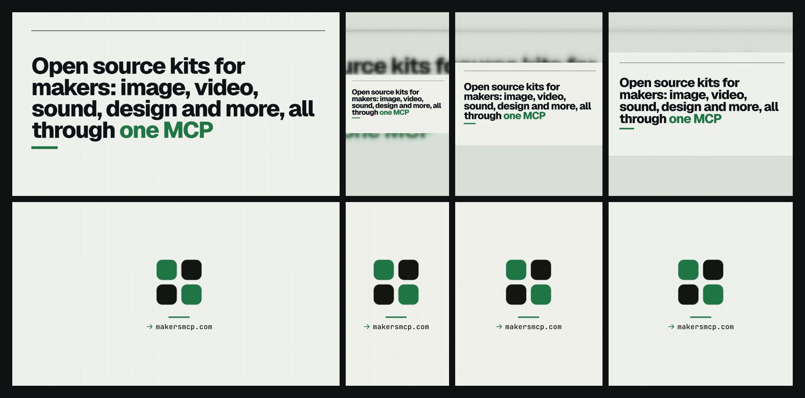

# reframekit

Turn one finished video into the version each place takes: 9:16 for TikTok, Reels and Shorts, 4:5 for the feeds, 1:1, and 16:9 for YouTube, X and LinkedIn. In each shot the crop follows what moves; a shot whose action or words are wider than the crop is shown whole on a blurred copy of itself instead. Every file is cut at a shot change to the place's length, kept under its file size limit and set to -14 LUFS, and gets a cover.

```bash
npx reframekit@latest film.mp4
```



A video is made in one shape and every place wants another. A crop from the middle cuts off whatever is not in the middle, a 16:9 film on TikTok shrinks to a band across the screen, a three minute cut is too long for X, and each app has its own limits for length, size and frame rate. reframekit reads the video once, finds its shots and where things move in each one, and plans a window for every shot and shape. It draws them all on `sheet.png` and writes them to `crop.json`, so you or your agent can look before anything renders and move a window that misses. Then it renders each place's file and checks it against the limits the place publishes.

The crop follows motion, not faces. Nothing in it recognizes people or objects, so look at `sheet.png` before the files go out.

The clip can come from any video model, and [Wiro](https://wiro.ai/explore/image-to-video) has several.

## Requirements

- Node.js 22 or newer.
- ffmpeg and ffprobe 4.4 or newer, Ubuntu 22.04's 4.4.2 included. ffmpeg has to be a build made with `--enable-gpl`, as Ubuntu's is: cropdetect and eq, two of the filters it uses, come only in such a build, as libx264 does. To render the files, ffmpeg needs an H.264 encoder: libx264, the one every test has used, or VideoToolbox, OpenH264 or Media Foundation, which no test has run with; a plan and a check need none. The other filters it uses are ffmpeg's own, and so is the AAC encoder. `brew install ffmpeg` and `winget install ffmpeg` give a new enough one, and so does `sudo apt install ffmpeg` on Ubuntu 22.04, Debian 12 or newer. Set `FFMPEG_PATH` to use another build, as a path or a name on your PATH; given as a path, it also picks the ffprobe next to that ffmpeg. Set `FFPROBE_PATH` for an ffprobe other than that one or the `ffprobe` on your PATH. `LAUNCH_FILM_FFMPEG` and `LAUNCH_FILM_FFPROBE`, as launch-film reads them, work too. Before any work, a run checks that ffmpeg and ffprobe start and answer as ffmpeg and ffprobe; one that does not stops the run with what the system or the program said, and how to get one. When the system is short of open files, processes or memory to start one, the run says so and what to do. The run then checks that ffmpeg has the filters it uses, and a render that it has an H.264 and an AAC encoder, and says what is missing. It does not check the version number ffmpeg gives, so an ffmpeg older than 4.4 that has them goes ahead, though no test has run on one.
- Linux, where it is tested: on Ubuntu 22.04 with its ffmpeg 4.4.2 and on GitHub's ubuntu-latest runner (Ubuntu 24.04 with ffmpeg 6.1 at this release), on every push and before every release. This release has also run on Ubuntu 26.04 with ffmpeg 8.0. It is written for macOS and Windows as well, but it has not been run on either.
- Room on the disk for the files of a run and those of the run before it, as the earlier files stay until the new ones are in place. Until a run ends, it also keeps a copy of an MPEG-TS or MPEG-PS (.ts, .mts, .m2ts, .mpg, .vob), about as large as the video, in its hidden folder in the out folder. A file encoded again in two passes, as one over its place's size limit is, also takes x264's notes on the first pass until it is done, about 26 MB a minute of a 1080x1920 file at 30 fps.
- Memory for ffmpeg, more for a video of more pixels, for a 10-bit one, as a phone's HDR video is, and on a machine with more cores. ffmpeg counts the cores it may run on, not a CPU quota: held to 2 CPUs by a quota, as `docker run --cpus=2` or a Kubernetes CPU limit sets one, on a machine with 24 cores, it took as much as on all 24, while held to 2 cores, as `taskset -c 0,1` holds it, it took the 2 core figure. For the places' files, from a 1920x1080 video, ffmpeg took about 0.6 GB on 2 cores and 1.5 GB on 24 to render a 1080x1920 file, as much for a minute of video as for six seconds, and from a 10-bit one about 0.65 GB and 1.6 GB. From a 3840x2160 video it took 0.8 to 1.1 GB on 2 cores and 1.9 to 2.5 GB on 24, and from a 10-bit one 1.2 to 1.5 GB and 3 to 3.6 GB. At that size a plan alone can take as much, as it reads four frames of the video at once for sheet.png. A larger size given with `--for` takes more: a 3840x2160 file from that video took about 2 GB on 2 cores and 5 GB on 24, and from a 10-bit one 2.3 GB and 5.6 GB. Node's part grows with the length of the video: planning a one hour video took about 250 MB (see [Limits](#limits)).
- A run needs no network access, no browser and no API key: reframekit reads files on your disk, and nothing leaves your machine. Installing it needs the network, and `npx reframekit@latest` asks npm for the newest version each time it runs. There are no npm dependencies: ffmpeg reads and writes the video, and the rest is plain JavaScript.

## What you get

```
reframekit-film/
  tiktok.mp4         1080x1920, H.264 and AAC at -14 LUFS
  reels.mp4          the same picture; a copy of tiktok.mp4 when it fits both
  shorts.mp4         1080x1920
  youtube.mp4        1920x1080
  x.mp4              1920x1080, cut to 140 s when longer
  linkedin.mp4       1920x1080
  feed.mp4           1080x1350
  square.mp4         1080x1080
  tiktok-cover.jpg   a frame of each file, for its cover (one per file)
  crop.json          the window for every shot and shape, to edit
  sheet.png          every shot's frames with each shape's window drawn on them
  sheet-2.png        and on: twelve shots to a page, for a video of many shots
  formats.json       every file's size, length, loudness, cut and checks
  FORMATS.md         the same for people and agents, with each limit's source
```

- Shots come from the picture: hard cuts from ffmpeg's scene change scores on a small RGB copy, and dissolves where the picture before and after a moment differ far more than either side changes, once a change of light is taken out, so light that comes up over a picture as a camera's exposure settles splits no shot. A flash, where the picture turns and comes back within a quarter second (white frames, a camera flash fading back), is not taken for a cut, and neither is the start of a fade or of a slow camera move; one that starts all at once, as a whip pan, can be. launch-film's `film.timeline.json` next to a film gives its clips exactly, and they are its shots, as launch-film's own check takes them: a title that comes in inside a clip is no cut. easyscreenshotkit's `steps.json` next to a demo gives its pages, its page box and where the pointer pressed. `--cuts` gives them by hand, in place of all of these.
- In a shot the window holds still while what moves stays inside it, and glides with an eased start and stop when it does not. It keeps what moves whole first and centered second. In a shot where nothing moves it holds on the part with the most detail. In a demo it goes to each press and stays on the page, off the backdrop.
- A shot is padded when a crop would cut what matters: what moves spreads wider than the window while the camera holds still (two people far apart, a title flying in), or the detail does (the words of a slide or a page). The whole picture then sits on a blurred, darkened copy of itself, or on a color with `--pad`, or on the page background of an easybrandkit folder with `--brand`. A camera that pans is followed, not padded.
- Black bars around the picture are found and left out, a phone video stored sideways is turned upright, pixels that are not square are made square, and a frame rate that varies becomes a steady one at its fast rate, as a screen recording's scrolls need. A picture that ends more than half a second before its sound holds its last frame until the sound ends, in each file that runs that far, and `FORMATS.md` says which files and from when. A video whose container leaves out its length (a browser's recordings often do) is measured, from where its picture and sound start. An MPEG-TS or MPEG-PS (.ts, .mts, .m2ts, .mpg, .vob) is read from a copy in an MP4, made in the run's hidden folder as ffmpeg copies such a file, since it has no index to find a frame by: the sheet then shows each moment's own frame, and where its times jump back, or ahead by more than ten seconds, as where two recordings were joined, the parts come back to back. The copy takes as much room as the video until the run ends.
- Places that need the same picture share one encode: TikTok, Reels and Shorts get one file when the video fits all three, and with `--mode fit`, so do places of any shape whose frames fit the picture at the same size, as the 9:16, 4:5 and 1:1 frames fit a 16:9 picture.
- A file too long for its place ends at the last shot change that keeps at least 70% of the time allowed, or at the limit with a half second fade when no shot change is near. It ends a tenth of a second under its place's limit at the latest, so a shot change on the limit, as one on a round second can be, or on the frame just after it, where a cut on a round second falls in a video at 29.97 fps, ends it just before that change. A file over its place's size limit is encoded again in two passes at the bit rate that fits, and one under its least size (LinkedIn takes 75 KB at least, more than a short still title card comes to) at a steady bit rate that reaches it with what its sound takes, each up to three times while it still misses; `FORMATS.md` says what it came to.
- The sound is set to -14 LUFS (`--lufs`) with ffmpeg's loudnorm in two passes, true peaks under -1 dBTP, as stereo AAC at 48 kHz, and it lands on its frame, also where the picture and the sound start at different moments in the file, as in an MPEG-TS from a camera. Each file's sound is measured again and set again when it missed: a peak over -1 dBTP, or a loudness more than half a unit off, as sound with sharp clicks in a quiet room comes out. `FORMATS.md` gives what each file measured. Sound raised by more than 30 dB to reach the target, as a recording of little but room tone is, gets a note with what it measured, since its hiss is raised as much; sound under -70 LUFS is taken for silence and left as it is.
- Every MP4 has its index before its media and no edit lists, as Instagram's API asks and YouTube recommends.

## The places

| Place | File | Length | File size | From |
| --- | --- | --- | --- | --- |
| TikTok | 1080x1920 | 3 min (TikTok gives some accounts 5 or 10) | 4 GB | [TikTok's media transfer guide](https://developers.tiktok.com/docs/en/content-posting-api-media-transfer-guide) |
| Instagram Reels | 1080x1920 | 3 s to 15 min | 300 MB, 25 Mb/s | [Instagram's Graph API reference](https://developers.facebook.com/docs/instagram-platform/instagram-graph-api/reference/ig-user/media) |
| YouTube Shorts | 1080x1920 | 3 min, square or vertical | 256 GB | [YouTube Help on Shorts](https://support.google.com/youtube/answer/15424877) |
| YouTube | 1920x1080 | 15 min (12 hours once the account is verified) | 256 GB | [YouTube Help on long uploads](https://support.google.com/youtube/answer/71673) |
| X | 1920x1080 | 2 min 20 s without a subscription | 512 MB | [X Help Center](https://help.x.com/en/using-x/x-videos) |
| LinkedIn | 1920x1080 | 3 s to 15 min | 75 KB to 5 GB | [LinkedIn Help](https://www.linkedin.com/help/linkedin/answer/a548372) |
| Feeds (4:5) | 1080x1350 | as Reels | as Reels | Instagram's limits, the strictest of the feeds |
| Square | 1080x1080 | | | general checks only |

Each page was read on 2026-11-07, and only a place's own pages count: guides on the web disagree. Where two of a place's pages disagree the stricter one is kept, as for X, whose API page gives 20 minutes and 8 GB. A MB is read as a million bytes and a GB as a billion, the stricter reading too. Frame rates, sizes, codecs and the MP4's layout are checked as well; `FORMATS.md` lists every limit with its page.

## Use it with your agent

reframekit ships as an [Agent Skill](https://agentskills.io). Install it once and your agent runs it by itself when a video has to go somewhere in another shape:

```bash
npx skills add EminBudak/reframekit
```

That covers Claude Code, Codex, Cursor and the other agents the [`skills`](https://github.com/vercel-labs/skills) CLI supports. In Claude Code you can add it as a plugin instead:

```
/plugin marketplace add EminBudak/reframekit
/plugin install reframekit@reframekit
```

In GitHub Copilot CLI it takes the same two steps:

```bash
copilot plugin marketplace add EminBudak/reframekit
copilot plugin install reframekit@reframekit
```

Then ask as usual:

> Make the TikTok, Reels and square versions of launch.mp4

The skill carries its own script, so it installs nothing else and needs no API key.

## Use it from the command line

```
npx reframekit@latest <video> [options]
npx reframekit@latest <video> --plan [options]
npx reframekit@latest check <folder|formats.json|file.mp4> [options]

Options:
  --for <places>     any of tiktok, reels, shorts, youtube, x, linkedin,
                     feed, square, all, or a size such as 1080x1350, comma
                     separated, 12 at most (default: all)
  --mode <mode>      follow (default), center, pad (the whole picture on a
                     blurred copy or a color) or fit (keep the picture's
                     shape, only fit each place's limits)
  --pad <what>       behind a padded picture: blur (default), black, white,
                     a color like '#0f172a' (quoted, or the shell drops it)
                     or 0f172a, or brand (needs --brand)
  --brand <path>     an easybrandkit folder, its brand.json or _brand.yml:
                     padded pictures sit on the page's background color
  --crop <file>      render the windows of an edited crop.json; those of a
                     shape it has none of are planned for its shots
  --cuts <list|file> the shot changes, as seconds (3.2,7.5) or a JSON file:
                     seconds, { "fps", "cuts" }, a launch-film timeline or
                     easyscreenshotkit's steps.json; they replace the cuts
                     found, so give them all (default: found)
  --steps <file>     easyscreenshotkit's steps.json, for a demo whose
                     steps.json is not next to it
  --seconds <time>   keep at most this long in every file, cut at a shot
                     change, e.g. 30 or 1:30
  --no-trim          never cut a file to a place's length; say it is over
  --lufs <n>         loudness target, -40 to -5 (default: -14)
  --fps <n>          frame rate of the files, 10 to 60 (default: the
                     video's, kept between 23 and 60)
  --cover <time>     the moment the covers show (default: picked)
  --out <dir>        where to save (default: ./reframekit-<video name>). A
                     folder of an earlier run of the same video is used
                     again: the files this run makes are replaced, the
                     other places' files kept, and a crop.json edited by
                     hand is only rendered with --crop, never planned over
  --plan             only plan: crop.json, sheet.png and FORMATS.md, no MP4
  --json             print formats.json (or crop.json, or check.json)
  --dry-run          check the arguments and the folder, and say what would
                     be made or why the run would stop, without reading
                     the video or starting ffmpeg
  -h, --help         show this help
  -v, --version      show the version

Check options:
  --for <places>     the places to check a lone MP4 against (default: the
                     places of its shape); with a folder, only these
  --captions <file>  an ASS, SRT or WebVTT file burned into the video: its
                     timing is checked, and an ASS file's text against
                     each 9:16 place's safe area
  --out <dir>        where CHECK.md and check.json go (default: the folder
                     checked, or reframekit-check-<name> next to an MP4)
  --json, --dry-run  as for a run: print check.json, or say where CHECK.md
                     would go, or why the check would stop, measuring nothing
  It exits with 1 when a file fails a place's limits.
```

Quote a color that starts with `#`, as `--pad '#0f172a'`: a shell takes an unquoted `#` for the start of a comment and drops the rest.

Some runs:

```bash
npx reframekit@latest film.mp4 --for tiktok,reels,square
npx reframekit@latest demo.mp4 --plan
npx reframekit@latest demo.mp4 --crop reframekit-demo/crop.json --out reframekit-demo
npx reframekit@latest clip.mp4 --for shorts --seconds 59
npx reframekit@latest talk.mp4 --for feed --mode pad --brand easybrandkit-acme.com
npx reframekit@latest check reframekit-film --captions captions.ass
```

Installed globally (`npm install -g reframekit`), the command is `reframekit`. npx keeps the copy an earlier run fetched, so `npx reframekit@latest` is how you get a newer version. What a run needs is under [Requirements](#requirements).

Set `REFRAMEKIT_DEBUG=1` to see each ffmpeg and ffprobe command as it starts and the numbers behind every window.

## Move a window

`crop.json` holds every shot and, for each shape, its window: its mode and its path, each point the second and the x and y of the window's top left corner in the video's own pixels.

```json
{
  "n": 3,
  "start": 8.4,
  "end": 12,
  "windows": {
    "9:16": { "mode": "follow", "w": 608, "h": 1080, "path": [[8.4, 656, 0], [9.6, 656, 0], [10.4, 980, 0], [12, 980, 0]], "keeps": 0.96 },
    "1:1": { "mode": "pad" }
  }
}
```

One point holds a window still and more points glide through them. Set `mode` to `pad` to show a shot whole or to `follow` to crop it, and make `w` and `h` smaller in the same shape to zoom in. To crop part of a shot and pad the rest, split it into two shots, each at least 0.4 s long with its own windows. `keeps` is the share of what moves that stays inside the window.

Then render it again with the command the run printed, which `FORMATS.md` gives too. It starts with the program the way you ran it (npx with the version that ran, node with the script's path, or `reframekit` when installed globally), quotes names as the shell reads them and carries the options of that run that crop.json does not hold (`--pad`, `--brand`, `--seconds`, `--no-trim`, `--lufs` and `--fps`), so the files come out as before with the new windows, such as `reframekit film.mp4 --crop reframekit-film/crop.json --for tiktok,square --out reframekit-film --lufs -16`. A name that needs quotes goes in single quotes, and on Windows in double quotes, which cmd, PowerShell and Git Bash all take, or in single quotes when it holds a sign PowerShell or Git Bash would still read inside double quotes, such as a $ or a backtick. cmd takes no single quotes, so type such a name there in double quotes. Rendered for fewer places than it was planned for, crop.json keeps the windows of the other shapes as they were. Given a place of a shape it has no windows of, a `--crop` run plans that shape's windows for crop.json's shots and keeps the rest; add `--plan` to look at them before anything renders.

## Run again

A run into a folder that holds an earlier run of the same video replaces the files it makes again and keeps the rest: the files of places it was not asked for (`FORMATS.md` marks them as from an earlier run), and, for `--plan`, every rendered file. It removes the sheet pages of the earlier run that it does not draw again, and a check of the earlier files, which no longer holds once files are made again: `CHECK.md` and `check.json` in the folder, or a `reframekit-check-<name>` folder in it that holds only a check of its `formats.json` or of a file the run makes again, such as `reframekit-check-tiktok` for tiktok.mp4. It never replaces a file reframekit did not write, or one changed since, as the size and the hash it records for each file tell: the run stops before any work and names the file. formats.json is the one exception: a render writes it anew whatever reframekit's own formats.json says, and measures again the files it keeps; a plan leaves it as it is, and a formats.json that is not reframekit's stops the run like any other file it did not write. A kept file that cannot be measured, as one ffprobe crashes on, stays listed as before, failing, with a note that says why, until a run measures it. It looks again at the end, before the finished files move in, so a file it would replace or remove that is changed while it renders, or one of those names saved into the folder meanwhile, stops the move; other files saved there meanwhile are left alone. The folder then stays as it was, and the error names the hidden folder that holds the finished files, made from what the folder held when the run started. That folder stays until you remove it: take what you need from it, run again, then remove it. A run that fails or is refused leaves the folder as it was too, and so does one stopped with Ctrl-C or a signal, which says so (with `--json` on stdout as well, as `{"ok":false,"error":"stopped by SIGTERM, so reframekit-film is as it was"}`) and ends by that signal. A run killed outright (`kill -9`, or the system when memory runs out) cannot tidy up: its hidden folder, `.reframekit-` and an id, stays in the folder with what it had made, which for an MPEG-TS or MPEG-PS can be a copy as large as the video, and the next run there removes it once the killed run's process is gone. The files a system leaves in a folder (.DS_Store and ._ files on a Mac, Thumbs.db and desktop.ini on Windows) are passed over; a folder or a link of such a name counts as someone's. A file named like one it writes in other letters, such as Square.mp4 for square.mp4, counts as someone's too, since a disk that ignores letter case (as on a Mac or Windows) takes the two names for one file. Without `--crop` a run plans again, so it stops too when crop.json was edited by hand, also after a `--crop` render has written it again: render that one with `--crop`, or move it away. A folder holds the run of one video, told apart from others of its name by where it is: without `--out`, another video of the same name (clip.mov after clip.mp4, or the film.mp4 of another folder, as launch-film names every film) gets reframekit-clip-2, and with `--out` a folder of another video's run is refused. A video made again in its place keeps its folder, and `FORMATS.md` says which kept files were made before it changed.

## The check

`reframekit check` measures finished files against a place's limits without changing them: shape, size, frame rate, length, file size, codecs, and whether the MP4 is whole, with its index first and no edit lists. A file that a copy or a recording cut short fails wherever the cut falls, as its boxes tell: one whose media runs past its end, or is missing after its index, though ffprobe reads the index; one cut inside its index, which ffprobe cannot read; and a fragmented one cut inside a fragment, or inside the index of its fragments that some writers put at its end. A fragmented MP4 cut exactly between two of its fragments is a whole file, only shorter, and passes. A run refuses before any work a video cut short so that media it lists is not there, in the same words, and where ffprobe still reads its index says what to do: copy or download it again, or, for a recording that stopped part way, make a whole file of the part that is there, as `ffmpeg -i rec.mp4 -c copy whole.mkv` does, and reframe that. Where the file holds none of its media, as a copy that stopped where its index ends, or not even the first frame of its picture whole, though some of its sound may be there, it says which, and only to copy or download it again: ffmpeg's copy of such a file would hold nothing to reframe. A fragmented MP4 cut only inside the index of its fragments, or in the header of the box after its last whole fragment, still has all its media: the check fails it, and a run takes it. A whole MP4 followed by bytes that make no box, as the line break or the text a broken upload can leave, passes the check with a warning, and a run takes it. That holds for a fragmented MP4 that ends with the media of its last fragment as well, unless those bytes could start the header of a next fragment, as one or two zero bytes could: they then count as a cut in that header. Given a folder reframekit made, it checks each file for its place, and a file of it that is missing, or that ffprobe cannot read or crashes on, fails its own row while the others are measured; given one MP4, the places of its shape or `--for`. With `--captions` and an ASS file it also checks that the burned in text stays inside a 9:16 place's safe area, each line's box estimated from its style and scaled to the video as libass draws it (no font is opened). It writes `CHECK.md` and `check.json` into the folder it checks, or for one MP4 into a folder of its own next to it, `reframekit-check-<name>` (`reframekit-check-<name>-2` when that one holds the check of another file of the name), and exits with 1 when a file fails. It never replaces a `CHECK.md` or `check.json` it did not write. A check stopped with Ctrl-C or a signal has written nothing yet, and says so.

Loudness, black, still and silent stretches are what [launch-film](https://github.com/EminBudak/launch-film)'s `check` measures, for any video.

## How it works

1. One ffmpeg pass reads the picture: scene change scores on a small RGB copy, black bars with cropdetect, and ten small frames a second (five past twenty minutes, two and a half past an hour), 128 cells on the long side, piped to Node as raw bytes.
2. For every cell Node measures what changed since the frame before, above a noise floor, and how much edge there is, and sums both along each column and each row. A frame whose change is mostly explained by shifting the whole picture is a camera move.
3. Each window can slide along one axis: across a picture wider than its shape, down one that is taller. A dynamic program picks one place for it in each frame of the shot, paying for what moves and falls outside it, for having it off center, and for every move, so the window holds until holding costs more than moving. Each move becomes an eased glide.
4. The window's share of what moves and of the detail, and how wide each spreads, decide whether a shot is cropped or padded.
5. ffmpeg renders each file: the window's path reaches its crop filter as a sendcmd file, one line for every frame the window moves; a padded shot is drawn over the crop for its stretch of time. x264 encodes it with two B-frames and closed GOPs, as YouTube recommends.
6. loudnorm measures the sound, then sets it, and the AAC file is measured again: the encoder lifts sharp peaks, by up to 2 dB at 128 kb/s, so when a true peak comes out over -1 dBTP the sound is set again under a lower ceiling. The first 1024 samples are dropped, since the AAC encoder puts as many of its own before the sound and no edit list hides them, so the sound stays on its frame.
7. Each file is probed, its MP4 boxes are read, and the result is checked against its place.

## Limits

- The crop follows motion, not faces or objects. A person who sits still while something behind them moves can lose the window to it. Look at `sheet.png` and move the window in `crop.json`.
- It pads by the numbers: a talking head next to a busy bookshelf can come out padded because the shelf's detail spreads wide. Set the shot to `follow` in `crop.json`.
- A shot is cropped or padded as a whole. To switch inside a shot, split it in two in crop.json and render with `--crop`.
- A camera move that starts all at once, as a whip pan, can be taken for a cut: the shot is split there and the window starts again in the middle of the move. Join the two shots in crop.json, or give every cut with `--cuts`.
- A dissolve between two similar pictures can go unseen, and so can one that lasts longer than about two seconds or one between two pictures that differ only in their light; the window then glides across it. Split the shot in crop.json, or give every cut with `--cuts` (it replaces the cuts found); launch-film's timeline sets a film's shots exactly.
- Light that changes all at once, as a lamp switched on, can be taken for a cut, and the shot is split there. Join the two shots in crop.json, or give every cut with `--cuts`.
- It does not zoom in by itself; a smaller window in `crop.json` does.
- It does not yet cut the stretches where the picture stands still and nothing is said. That is planned for the next version.
- A long video takes memory in step with its length, for what is kept of its small frames: planning a one hour video took about 250 MB here, and a three hour one about 360 MB. Most of the time goes to ffmpeg decoding the picture, once to read it and once more for each file it renders.
- HDR video is not tone mapped, so its colors come out flat. Convert it to SDR first.
- A video joined from two recordings whose times jump comes out with its parts back to back, as ffmpeg copies it, and the sound of the later part can land a few hundredths of a second after its picture. Times that jump ahead by ten seconds or less are a gap ffmpeg keeps: the picture holds and the sound is silent until the later part starts, and `FORMATS.md` says where.
- A picture that changes its size part way, as two recordings of different sizes joined or a browser's WebM of a window that was resized, is read and rendered at the size of its first frames, and a later part of another shape is stretched to it.
- Only the first sound track is used. A recording with the voice on a track of its own, as OBS can write it, comes out without that voice, and `FORMATS.md` says so. Mix the tracks into one first.
- TikTok and YouTube publish no numbers for their safe areas, so Meta's margins for Reels stand in for them in the caption check, and only an ASS file says where its text sits.
- The caption check estimates each line's box from its style without opening the font, and the estimate errs wide: a caption close to a margin can fail though it fits. Look at a frame of the file before moving the caption.
- The limits are what each place's pages said on 2026-11-07. A place can change them, and a longer limit for some accounts (TikTok's 10 minutes, a verified YouTube account) needs `--no-trim`.
- It does not check whether you may post the video.

## See also

- [launch-film](https://github.com/EminBudak/launch-film) turns a site into a short launch film, rendered on your machine, and checks any video.
- [easyscreenshotkit](https://github.com/EminBudak/easyscreenshotkit) saves clean screenshots of a website and records a demo video of it.
- [musicfit](https://github.com/EminBudak/musicfit) fits a music track to a video cut.
- [easybrandkit](https://github.com/EminBudak/easybrandkit) saves a site's real logo files, colors and fonts as a brand kit.

## License

MIT
